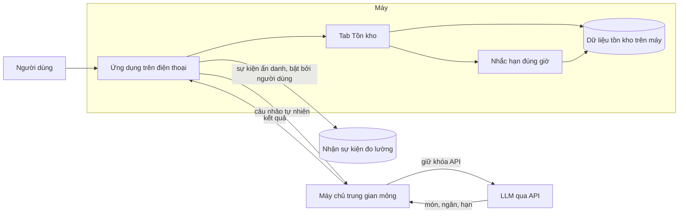

# Tủ Lạnh Trong Túi

> Tài liệu ý tưởng sản phẩm. Trạng thái: **đề xuất, chưa có dữ liệu người dùng thật**. Các con số và nhận định về đối thủ là kiến thức có sẵn, cần kiểm chứng lại trước khi dùng để quyết định.

## 1. Giới thiệu bài toán

Hầu hết mọi người đều quen với cảnh đứng trước tủ lạnh, mở cửa và không nhớ mình đang có gì. Trứng còn hay hết, rau đã héo chưa, thịt mua hôm trước còn ăn được không. Kết quả là mua thừa, mua trùng, và phần lớn đồ tươi bị bỏ đi trước khi kịp dùng.

Vấn đề cốt lõi là **quản lý đồ trong tủ lạnh**: biết mình đang có gì, còn bao lâu, và cần bổ sung gì. Các việc khác như gợi ý món ăn đều dựa trên dữ liệu này, nên chỉ có giá trị khi dữ liệu tồn kho đúng.

Tủ Lạnh Trong Túi tập trung giải quyết việc đó trước, với thao tác đủ nhanh để người dùng thực sự duy trì.

## 2. Khó khăn khách hàng đang gặp

Khách hàng mục tiêu là người đi làm tự nấu ăn tại nhà, đi siêu thị hoặc chợ tích trữ thực phẩm 1–3 lần mỗi tuần. Các khó khăn cụ thể:

- **Quên đồ trong tủ.** Mua thêm trứng, sữa, rau trong khi trong tủ vẫn còn.
- **Đồ bị bỏ quên ở góc tủ.** Hạn dùng qua đi mà không ai nhận ra, đặc biệt ở ngăn đông và góc sâu của ngăn mát.
- **Danh sách mua thiếu hoặc trùng.** Nhớ ra cần gì thì đã ở siêu thị, hoặc đã về nhà.
- **Nhập liệu quá nhiều.** Với phần lớn người dùng, việc gõ từng món, từng số lượng, từng hạn dùng là lý do bỏ app sau vài tuần.

## 3. Những cách đã có trên thị trường

Các nhóm giải pháp hiện có:

| Nhóm | Ví dụ | Điểm mạnh | Hạn chế với nhu cầu trên |
|---|---|---|---|
| Quản lý kho gia đình mã nguồn mở | Grocy | Đầy đủ tính năng kho, hạn dùng, công thức | Phải tự host, giao diện và cài đặt phức tạp, không phù hợp người dùng phổ thông |
| Lập kế hoạch bữa ăn và danh sách mua | Mealime | Lên thực đơn và danh sách mua sắm tốt | Không theo dõi tồn kho thực tế, món ăn chủ yếu kiểu Âu–Mỹ |
| Theo dõi lãng phí thực phẩm | NoWaste | Miễn phí, tập trung vào hạn dùng và lãng phí | Nhập liệu thủ công, ít gợi ý món từ đồ có sẵn |
| Quản lý công thức | Paprika | Lưu và tổ chức công thức rất tốt | Là kho công thức, không biết bạn đang có gì trong tủ |
| Tủ lạnh thông minh | Samsung Food / Family Hub | Có quản lý tủ lạnh tích hợp | Phụ thuộc phần cứng đắt tiền, ít người dùng |

> Thông tin về tính năng và giá của các app này là kiến thức có sẵn và có thể đã thay đổi. Cần kiểm tra lại trên App Store, Google Play và website chính thức trước khi dùng.

## 4. Điều chưa được giải quyết

Không có giải pháp nào giải quyết trọn vẹn các vấn đề sau cùng lúc, đặc biệt trong bối cảnh Việt Nam:

1. **Nhập liệu vẫn là điểm chết.** Các app mạnh nhất đều đòi hỏi nhập từng món hoặc quét mã vạch. Thực phẩm mua ở chợ truyền thống không có mã vạch.
2. **Hạn dùng thực phẩm Việt chưa có dữ liệu mặc định.** Người dùng phải tự nhập ngày hết hạn cho từng bó rau, từng miếng thịt.
3. **Ngăn tủ và hạn dùng chưa gắn với nhau.** Cùng một miếng thịt ở ngăn mát và ngăn đông có hạn khác hẳn, nhưng đa số app không xử lý điều này.
4. **Chia sẻ trong gia đình thường bị khóa sau thu phí.** Đặc biệt khi nhiều người cùng cập nhật một tủ lạnh.

## 5. Mô hình của chúng tôi

Tủ Lạnh Trong Túi là ứng dụng quản lý đồ trong tủ lạnh theo **trạng thái định tính** thay vì số lượng chính xác. Gợi ý món ăn và danh sách đi chợ là các tính năng xây trên nền tồn kho đó, và được đưa sang bản sau.

Ba nguyên tắc cốt lõi:

1. **Ba trạng thái cho mọi nguyên liệu.** Mỗi nguyên liệu chỉ có `Còn nhiều`, `Còn ít` hoặc `Hết`. Không cân đo gram, không đếm số lượng. Một chạm để cập nhật.
2. **Nhập bằng một câu tự nhiên.** Ví dụ: "mua 1kg cà chua, 2 vỉ trứng, 500g thịt bò". App tách món, gán ngăn và hạn dùng mặc định, rồi lưu thẳng. Người dùng sửa sau nếu cần.
3. **An toàn khi không chắc.** Khi không chắc ngăn, app lưu thẳng vào ngăn Mát với hạn ngắn hơn, không bao giờ mặc định ngăn Đông. Trên thẻ `Vừa thêm`, món đó có nhãn nổi bật `Mặc định ngăn Mát, chạm để đổi sang Đông`. Nhóm thực phẩm nhạy cảm (thịt, gia cầm, cá, hải sản, đậu phụ, sữa thanh trùng, giò chả) không bị chặn bằng hộp thoại khi nhập, nhưng khi bị hạ xuống `Hết`, cần xác nhận một chạm.

## 6. Luồng giải quyết vấn đề

Luồng MVP 1.0 chỉ có quản lý tồn kho và nhắc hạn. Các bước còn lại được đưa sang bản sau.

**Bước 0: Khởi tạo lần đầu (khoảng 30 giây).** Không bắt người dùng nhập cả tủ lạnh ngay. App hiện lưới 12–15 thực phẩm tươi phổ biến (trứng, thịt heo, thịt bò, gà, cá, đậu phụ, cà chua, rau xanh...). Người dùng chạm chọn những món đang có trong tủ. Phần còn lại được thêm dần khi người dùng đi chợ về. Đồ đã có sẵn trong tủ không được gán hạn như đồ vừa mua: app lấy nửa hạn mặc định và đánh dấu `Cần kiểm tra hạn`, vì không biết chính xác đồ đã để bao lâu. Bảng hạn mặc định theo loại thực phẩm là bảng cố định trên máy, không phải LLM suy luận mỗi lần, để cùng một loại luôn có cùng hạn. Nhóm gia vị nền (muối, đường, nước mắm, dầu ăn, hành, tỏi, mắm, bột ngọt, gạo) mặc định coi là luôn có, không đưa vào tồn kho.

**Bước 1: Đi chợ về, cất đồ vào tủ.** Người dùng gõ hoặc nói một câu tự nhiên. Nút nói là chạm một lần để bắt đầu, tự ngắt và gửi khi ngừng nói 3,5 giây (có vòng đếm ngược trực quan), để dùng được khi tay đang xách đồ. App tách món, gán ngăn và hạn mặc định, hiện thẻ `Vừa thêm`. Món trùng tên với món đang có được gộp vào món cũ, đặt `Còn nhiều` và cập nhật hạn theo lần mua mới, trừ khi ngăn khác nhau. Thẻ `Vừa thêm` không tự biến mất: nó đóng khi người dùng bấm đóng hoặc mở app lần sau.

**Bước 2: Nhắc hạn đúng lúc.** App gửi tối đa một thông báo mỗi ngày, vào giờ người dùng chọn (mặc định 16:30), chỉ khi có nguyên liệu nhạy cảm còn tối đa 1 ngày. Thông báo nêu tên nguyên liệu và ngăn, kèm hai nút hành động ngay trên thông báo: `Đã dùng hết` và `Vẫn còn`. Nhờ đó người dùng cập nhật tồn kho ngay lúc được nhắc, không cần mở app.

**Bước 3: Dùng đồ, cập nhật tồn kho.** Người dùng hạ bậc trực tiếp trên tab Tồn kho: một chạm trên dòng nguyên liệu. Tab Tồn kho sắp xếp theo hạn vàng hoặc đỏ trước, nên đồ cần dùng luôn nằm đầu danh sách. Mọi lần hạ bậc được ghi vào mục `Lịch sử`, và có thanh hoàn tác 8 giây. Với nhóm nhạy cảm, khi hạ xuống `Hết`, app hỏi xác nhận một chạm, vì đây là nhóm có rủi ro hỏng lớn nhất. Người dùng có thể lọc nhanh theo ngăn `Mát | Đông | Khô`, và tìm theo tên.

**Bước 4 (bản 1.1): Gợi ý món ăn.** Tab Gợi ý trả về 3–5 món dựa trên tồn kho, ưu tiên nguyên liệu `Còn ít` hoặc sắp hết hạn. Thứ tự và danh sách món do code quyết định trên dữ liệu tồn kho. LLM chỉ đề xuất món ăn. Xem mục 9.

**Bước 5 (bản 1.1): Trước khi đi chợ.** Các món `Hết` hoặc `Còn ít` vào màn hình Đi chợ. Khi mua, người dùng đánh dấu từng món. Khi bấm `Hoàn tất đi chợ`, các món đã mua trở về `Còn nhiều` với hạn mới.

Nguyên tắc thao tác chung: không có màn hình xác nhận chắn ngang, trừ bước xác nhận hạ nhóm nhạy cảm xuống `Hết`. Mỗi thay đổi đều có hoàn tác, và mọi thay đổi còn xem lại được trong lịch sử.

## 7. Kết quả đo đạc

**Hiện chưa có dữ liệu.** Chưa có người dùng thật nào thử ứng dụng. Mọi đánh giá hiện có đến từ các vòng review bằng mô hình AI, không phải từ người dùng.

Các chỉ số sẽ đo khi có bản thử nghiệm. Các chỉ số dùng log cần một đầu nhận sự kiện ẩn danh (mục 9), vì log chỉ nằm trên máy thì không thu về được.

| Chỉ số | Mục tiêu đề xuất | Cách đo |
|---|---|---|
| **Chỉ số chính:** người dùng cập nhật tồn kho ít nhất 2 lần trong 7 ngày (thêm hoặc hạ bậc, không tính Bước 0) | Ít nhất 30% vào tuần thứ 2 | Sự kiện ẩn danh |
| Món bị gán sai ngăn hoặc hạn, mà sau 24 giờ chưa ai sửa | Gần 0, theo dõi riêng nhóm nhạy cảm | Đối chiếu sự kiện với người dùng |
| Tỷ lệ sửa lại tên, ngăn hoặc hạn sau khi nhập | Giảm dần qua các tuần | Sự kiện sửa |
| Tỷ lệ món tươi được hạ xuống `Hết` trước khi quá hạn | Trên 80% | Sự kiện và hạn dùng |
| Độ chính xác LLM khi tách câu nhập, gán ngăn và hạn | Từ 95% trở lên với nhóm nhạy cảm | Chạy bộ 50 câu bằng đúng model sản phẩm (xem mục 8) |
| Tỷ lệ bấm hoàn tác hoặc mở Lịch sử để sửa sau khi hạ bậc | Thấp, để phát hiện chạm nhầm | Sự kiện hoàn tác |
| Chỉ số phụ: mở app ít nhất 3 ngày mỗi tuần (sau 14 ngày) | Khoảng 50% người dùng | Chỉ số phụ, vì mở app chưa chắc có giá trị |

Kế hoạch thử nghiệm: 5–8 người thật nhập bằng giọng nói sau khi đi chợ về, trong tuần đầu. Trước đó, chạy bộ 50 câu nhập tiếng Việt (`test/cau-nhap-50.csv`), tập trung nhóm nhạy cảm. Lần chạy đầu bằng mô hình proxy (argon) đạt 50/50 theo tiêu chí trong `test/ket-qua-proxy.md`. Kết quả này chưa chứng minh gì về LLM sản phẩm. Bước bắt buộc tiếp theo là chạy lại bằng đúng model và prompt sản phẩm, rồi mới được tính độ chính xác 95%.

## 8. Thiếu sót và hướng sửa trong tương lai

**Chưa kiểm chứng**

- Chân dung người dùng mục tiêu chưa được phỏng vấn. Cần 5–10 cuộc phỏng vấn trước khi viết code nhiều hơn.
- Chưa biết người dùng có chịu mở app mỗi ngày hay chỉ khi đi chợ về.
- Ngưỡng nhóm nhạy cảm và khả năng LLM phân loại đúng tiếng Việt chưa được kiểm tra bằng model sản phẩm.
- Các mốc thời gian (hoàn tác 8 giây, nhắc 16:30, giọng nói 3,5 giây) là đề xuất tạm.

**Thiết kế cần sửa**

- Tab Tồn kho cần thử bố cục thật trên điện thoại nhỏ. Thẻ `Vừa thêm` và khung chờ xử lý cần gộp và có thứ tự rõ ràng.
- Vùng chạm trên một dòng nguyên liệu: chỉ nút trạng thái ở cạnh phải là thao tác chạm trực tiếp (48×48dp). Sửa tên, ngăn, hạn đưa vào bảng trượt.
- Phản hồi khi đang chờ LLM hoặc khi mất mạng chưa được thiết kế đầy đủ.

**Chưa có trong MVP 1.0**

- Gợi ý món ăn (bản 1.1, xem mục 9).
- Đi chợ và đánh dấu đã mua (bản 1.1).
- Ghim món đang nấu (bản 1.1).
- Đồng bộ nhiều thiết bị. Khi làm, quy tắc xung đột là giữ trạng thái đã dùng và hạn ngắn hơn, không bao giờ kéo dài hạn.
- Chia sẻ gia đình và phân quyền.
- Tích hợp đặt hàng với app giao hàng.
- Nhập bằng ảnh hóa đơn hoặc ảnh thực phẩm.
- Thống kê lãng phí bằng tiền.
- Hỏi ý kiến người dùng thật trong app (khảo sát ngắn, không quảng cáo). Xem backlog trong bản thiết kế.

**Mô hình kinh doanh** chưa được quyết định. MVP dự kiến miễn phí toàn bộ để kiểm chứng thói quen trước.

## 9. Kiến trúc tổng quan

Sơ đồ dưới đây cho thấy dữ liệu đi đâu trong MVP 1.0. Dữ liệu tồn kho chỉ nằm trên máy. Máy chủ rất mỏng, chỉ để giữ khóa API và nhận sự kiện đo lường.

Chú thích:

- **Ứng dụng trên điện thoại** có một màn hình chính trong MVP 1.0: Tồn kho. Gợi ý món và Đi chợ ở bản 1.1.
- **Dữ liệu tồn kho trên máy** lưu trạng thái, lịch sử hạ bậc, và câu nhập chưa gửi được. App vẫn dùng được khi mất mạng.
- **Nhắc hạn đúng giờ** là thông báo cục bộ, chạy từ dữ liệu trên máy.
- **Máy chủ trung gian** giữ khóa API của LLM, để khóa không nằm trong app. Nó không lưu tồn kho của người dùng.
- **LLM** trong MVP 1.0 chỉ tách câu nhập thành món, ngăn, hạn. Ở bản 1.1, LLM được thêm vai trò gợi ý món từ danh sách đã được code xếp sẵn theo hạn.
- **Nhận sự kiện đo lường** chỉ nhận sự kiện ẩn danh, và chỉ khi người dùng bật.

## 10. Phụ lục: Trạng thái tài liệu

- Phiên bản: 10. Thay đổi: trọng tâm MVP chuyển sang quản lý đồ trong tủ lạnh. Gợi ý món và đi chợ đưa sang bản 1.1.
- Phần chưa có dữ liệu thật: mục 7.
- Phần cần kiểm tra lại thông tin bên ngoài: mục 3.
